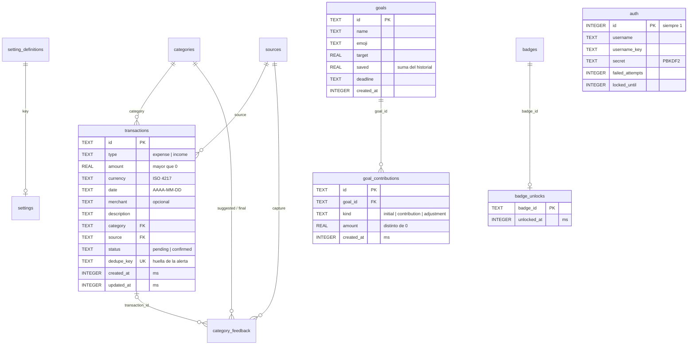

# Base de datos de MoneyMaker (SQLite · esquema v5)

| Archivo | Para qué sirve |
|---|---|
| `moneymaker.db` | La base lista para abrir en DB Browser for SQLite, con datos de ejemplo de agosto a octubre de 2026. |
| `esquema.sql` | Crea tablas, catálogos, índices, triggers y vistas. **La app usa este mismo archivo** para crear su base. |
| `migracion_v5.sql` | Pasa una base v4 a v5: añade el historial de aportes y las insignias. La app lo ejecuta al actualizarse. |
| `importar.sql` | Copia datos antiguos o de un respaldo corrigiendo lo que el esquema no admite. La app lo usa al migrar desde v3 y al restaurar respaldos. |
| `datos_ejemplo.sql` | 46 movimientos (2 pendientes), 3 metas con 11 aportes, 5 insignias ganadas, ajustes y 4 correcciones de categoría. |
| `consultas.sql` | Las mismas consultas que ejecuta la app (`FinanceDatabase.java`), con valores de ejemplo. |
| `construir.py` | Regenera `moneymaker.db` y corre 204 pruebas, incluidas las migraciones y las restauraciones. |
| `historial/esquema_v4.sql` | Copia congelada del esquema v4. No la usa la app; `construir.py` la usa para probar la migración v4 → v5. |

## Abrirla en DB Browser for SQLite

1. **Archivo → Abrir base de datos** → `database/moneymaker.db`.
2. **Estructura de la base de datos**: tablas, índices, vistas y triggers.
3. **Hojas de datos**: elige una tabla o una vista (`v_balance`, `v_goal_contributions`, `v_badges`, etc.).
4. **Ejecutar SQL** → abrir `consultas.sql` → F5 (todo) o Ctrl+Retorno (la consulta seleccionada).
5. **Editar pragmas**: deja marcada la opción **Claves foráneas**, que viene activa por defecto. Sin ella, SQLite no valida las relaciones.

Para rehacerla desde cero sin Python, crea una base nueva, ejecuta `esquema.sql`, luego `datos_ejemplo.sql`, y guarda con Ctrl+S. Si DB Browser pregunta por el `PRAGMA` del final, acepta.

Con Python (la reemplaza solo si todas las pruebas pasan; ciérrala antes en DB Browser):

```bash
python database/construir.py
```

## Diagrama



## Tablas

**Catálogos** (vienen cargados; reflejan lo que la app define en código):

- `categories`: las 15 categorías de `theme.js`, con etiqueta, color, ícono y si sirven para gastos, ingresos o ambos. Transferencias y Otros sirven para los dos.
- `sources`: origen del movimiento (manual, IA, voz, recibo, SMS, notificación) y si es automático.
- `setting_definitions`: los 9 ajustes que usa la app, con su tipo y su valor por defecto.
- `badges`: las 9 insignias de `gamification.js`. Cómo se gana cada una lo calcula la app.

Una prueba de Jest compara las categorías y las insignias de `esquema.sql` con las de la app, para que no se desalineen.

**Datos del usuario:**

- `transactions`: gastos e ingresos. Las alertas bancarias entran como `pending` hasta que el usuario las confirma.
- `goals`: metas de ahorro. `saved` es la suma de su historial y no se escribe a mano.
- `goal_contributions`: historial de cada meta.
  - **Saldo inicial**: lo que tenía al crearla o al migrar desde una versión anterior.
  - **Aporte**: los botones +50.000, +100.000 y +250.000.
  - **Ajuste**: cuando el usuario corrige "Ahorrado" a mano. Puede ser negativo.
- `badge_unlocks`: insignias ganadas y cuándo. Una vez guardada, la insignia sigue desbloqueada aunque se rompa la racha o baje el ahorro.
- `settings`: ajustes clave/valor. Si una clave no está, se usa el valor por defecto.
- `category_feedback`: correcciones de categoría (el feedback loop).
- `auth`: una sola fila con el usuario y el derivado PBKDF2 de la contraseña. En los datos de ejemplo está vacía.

## Reglas de coherencia

| Regla | Cómo se aplica |
|---|---|
| Montos mayores que 0; el signo lo da `type` | CHECK |
| Fechas reales en formato `AAAA-MM-DD` (rechaza `2026-02-30`) | CHECK con `date()` |
| Moneda de 3 letras mayúsculas | CHECK |
| Categoría y origen existentes | Claves foráneas |
| Un gasto no puede ser "Salario", ni un ingreso "Comida" | Trigger |
| Un movimiento confirmado no vuelve a pendiente; `created_at` no cambia | Triggers |
| La misma alerta (SMS y notificación) no se guarda dos veces | `dedupe_key UNIQUE` |
| Borrar un movimiento conserva su corrección, sin enlace | `ON DELETE SET NULL` |
| No se puede borrar una categoría o un origen en uso | `ON DELETE RESTRICT` |
| Ajustes con valores válidos (`true`/`false`, montos, milisegundos, moneda) | Clave foránea + triggers |
| Corrección: la categoría final distinta de la sugerida, confianza entre 0 y 1 | CHECK |
| El ahorro de una meta es siempre la suma de su historial | Triggers (recalculan `saved` y rechazan cambiarlo directo) |
| Una meta nueva empieza en 0; ninguna queda con ahorro negativo | Trigger + CHECK |
| Aporte y saldo inicial positivos; el ajuste puede ser negativo, nunca 0 | CHECK |
| Borrar una meta borra su historial | `ON DELETE CASCADE` |
| Cada insignia se gana una sola vez y conserva su primera fecha | Clave primaria + `INSERT OR IGNORE` |
| Una sola fila de acceso, contraseña nunca en texto plano | CHECK |

## Vistas

- `v_transactions` (con nombres legibles), `v_balance`, `v_monthly_summary`, `v_monthly_category_totals` y `v_pending_transactions`.
- `v_goal_progress` y `v_goal_contributions` (historial con el nombre de la meta).
- `v_badges`: todas las insignias, con su fecha de desbloqueo.
- `v_settings` (valor efectivo de cada ajuste) y `v_category_corrections`.

## Cómo la usa la app

- **Un solo esquema:**
  - Gradle copia `esquema.sql`, `importar.sql` y `migracion_v5.sql` a `assets/db/` en cada build (tarea `copy<Variante>DatabaseScripts` en `mobile/android/app/build.gradle`).
  - `FinanceDatabase` los divide en sentencias con `SqlScript.java` y los ejecuta, así que lo que ves en DB Browser es lo que crea el teléfono.
  - Si cambias el esquema: sube `VERSION` en `FinanceDatabase.java`, escribe el script de migración y añade su prueba en `construir.py`.
- **Claves foráneas:** se activan en cada conexión con `setForeignKeyConstraintsEnabled(true)` (SQLite las trae apagadas).
- **Migraciones** (dentro de la transacción de `onUpgrade`: si algo falla, la base queda como estaba):
  - **v4 → v5** (`migracion_v5.sql`): crea las tablas nuevas, y lo que cada meta tenía ahorrado pasa a ser su saldo inicial.
  - **v3 → v5** (`FinanceDatabase.rebuildFromVersion3`):
    1. Renombra las tablas a `legacy_*`.
    2. Crea el esquema actual.
    3. Copia los datos con `importar.sql`, que corrige lo que no se admite: categoría que no corresponde al tipo → Otros, corrección de un movimiento borrado → sin enlace, moneda en minúsculas, fechas inválidas… Descarta lo que no tiene arreglo, como movimientos con monto 0 o ajustes inválidos.
    4. Copia el acceso.
- **Respaldos:**
  - El `.mmbackup` (formato 3) incluye el historial de aportes y las insignias.
  - Al restaurar, cualquier respaldo se carga en tablas temporales sin restricciones y pasa por `importar.sql`. Los respaldos v1 y v2, que no tienen historial, reciben un saldo inicial por lo ahorrado.
  - La restauración es todo o nada.
- **Insignias:** `FinanceContext` las revisa después de cada cambio de datos, no solo al abrir Metas, y guarda las que llegan al 100 %. Así, una racha cumplida queda registrada aunque el usuario no abra esa pestaña ese día.
- **Versión de SQLite:** solo usa lo que existe en SQLite 3.9 (Android 7, `minSdk 24`).
- **Categorías coherentes desde el origen:**
  - `fitCategory()` (`mobile/src/theme.js`) ajusta la categoría al cambiar entre gasto e ingreso.
  - Los borradores de la IA con una categoría del tipo equivocado se sugieren como Otros, en la app (`toDraft`) y en el backend (`ai.to_parsed`).

La base local sigue sin cifrarse en reposo.
