# Manual de Administración y Sistema - MoneyMaker 2.0

> **Destinatarios:** desarrolladores, administradores de IT y usuarios técnicos que gestionan el entorno de MoneyMaker.
>
> **⚠ Versión sin IA (10 de noviembre de 2026).** La app entregada **ya no llama al backend**: se retiraron el registro por texto libre, el OCR de recibos, el chat abierto del Copilot y el envío de correcciones. Lo que cambió:
> * **Captura:** el botón + y "Escribir" abren el formulario "Nuevo movimiento". El micrófono transcribe literalmente la descripción (`SpeechRecognizer` de Android, que en muchos teléfonos usa internet de Google). La foto del recibo se guarda como evidencia, sin leerse, en `files/receipts/<id>-<marca de tiempo>.jpg` (`ReceiptStore.java`). No va en la base ni en el respaldo cifrado, se borra con el borrado total, y las de movimientos eliminados se limpian al abrir la app.
> * **Copilot:** cuatro preguntas fijas con respuestas calculadas en el teléfono (`mobile/src/lib/copilot.js`).
> * **Código retirado de la app:** `services/api.js`, `sheets/QuickEntrySheet.js`, `components/Extraction.js` y las constantes de red de `config.js` (`DEV_API_URL`, `PROD_API_URL`, `API_URL`, `APP_TOKEN`, `REQUEST_TIMEOUT_MS`).
> * **Vigencia del manual:** las secciones 1 (flujo y frontera de datos con el backend) y 3 (backend) describen el servicio FastAPI, que sigue en `backend/` como base para una futura versión con IA, pero **la app actual no lo usa**. Las capturas de la captura con IA (figuras 8 y 28) y de `config.js` (figura 22) corresponden a la versión anterior. Las secciones de base de datos, rendimiento, respaldo y mantenimiento siguen vigentes.
> **Alcance:** describe únicamente lo que el código del repositorio implementa (esquema SQLite v5, backend FastAPI, app React Native 0.87 con módulo nativo Android en Java). No existe un panel de administración web ni un servidor central de datos: cada teléfono es su propio "servidor" de datos.
> **Convención visual:** cada punto lleva su figura, y el pie de cada una indica de qué tipo es: **captura real** (la app en el emulador Android `Vida_Pixel`, DB Browser for SQLite 3.13.1, Swagger UI), **salida real** (consola, JSON y mediciones ejecutados durante la redacción), **código real** (fragmentos del repositorio) o **diagrama** (dibujado a partir del código). El único contenido ilustrativo, el JSON de un recibo, está marcado como tal. Los datos de las capturas de la app son de prueba.

* **Mapa del repositorio.** El proyecto es un monorepo con tres carpetas: `backend/` (microservicio de IA en Python), `database/` (esquema SQLite v5, scripts de migración, datos de ejemplo y `moneymaker.db`) y `mobile/` (app React Native + módulos nativos Android en Java, paquete `com.moneymaker.finance`). `docs/` contiene este manual y el manual de usuario; `branding/` contiene los logos.

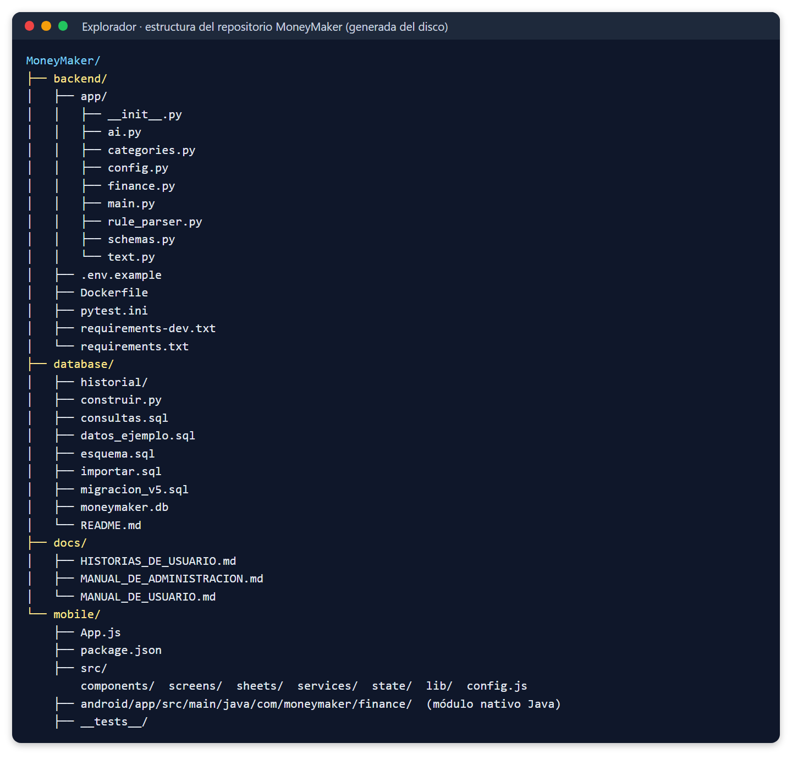

*Figura 1. Estructura real del repositorio (backend, database, docs y las carpetas clave de mobile).*


---

## 1. Arquitectura General del Sistema

Tres capas, un solo dueño de los datos: el teléfono. La base SQLite local es la fuente de verdad; el microservicio de IA es **sin estado** y solo transforma texto, fotos y resúmenes en JSON.

* **Vista general de las tres capas.** (1) **UI local**: React Native 0.87 en JavaScript, con `react-native-svg` para gráficos y `@react-native-community/blur` para el cristal. (2) **Core local**: Java en `mobile/android/app/src/main/java/com/moneymaker/finance` (SQLite, lector de SMS, lector de notificaciones, dictado, respaldo cifrado, `FLAG_SECURE`). (3) **Microservicio de IA**: FastAPI + Claude (`claude-opus-5` por defecto) con un motor de reglas en español como respaldo. La UI no habla con SQLite directamente: lo hace a través del módulo nativo `NativeModules.MoneyMaker`.

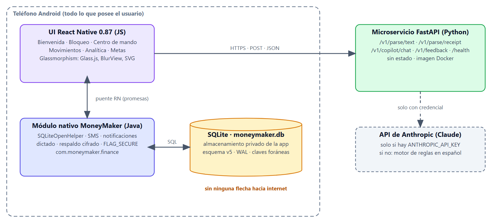

*Figura 2. Arquitectura de tres capas: UI React Native, núcleo local (Java + SQLite) y microservicio de IA sin estado.*

* **Capa de UI y puente nativo.** `mobile/src/` contiene `screens/`, `sheets/`, `components/` (incluye `Glass.js`), `state/` (`FinanceContext`, `AuthContext`), `services/` (`backup.js`, `storage.js`, `device.js`) y `lib/` (analítica, gamificación, formato). Las llamadas al puente devuelven promesas; los fallos nativos se registran en `logcat` con la etiqueta `MoneyMaker`, que es lo primero que se revisa cuando una promesa JS se rechaza sin explicación.

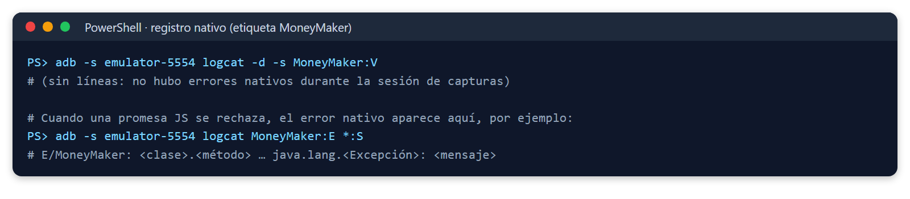

*Figura 3. Revisión del registro nativo: salida real vacía (sin errores) y el filtro a usar cuando una promesa JS falla.*

* **Capa de datos local.** Un único archivo `moneymaker.db` (esquema v5) en el almacenamiento privado de la app, abierto con `SQLiteOpenHelper` con claves foráneas activadas en cada conexión y `enableWriteAheadLogging()`. Por eso, junto al `.db` pueden aparecer `moneymaker.db-wal` y `moneymaker.db-shm`. El esquema vive en `database/esquema.sql`; Gradle lo copia a `assets/db/` y `FinanceDatabase` lo ejecuta, así que no hay una segunda copia del esquema en Java. En iOS no existe módulo nativo: la UI funciona con un almacén en memoria y no hay persistencia real.

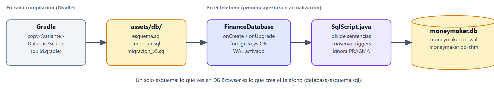

*Figura 4. Cómo nace la base: Gradle copia los scripts a assets y FinanceDatabase los ejecuta con SqlScript.*

* **Capa de IA.** Servicio FastAPI sin estado: no guarda transacciones ni imágenes y no registra el contenido de las solicitudes. Expone cuatro endpoints de negocio y un chequeo de salud.

  | Endpoint | Entrada | Salida |
  |---|---|---|
  | `GET /health` | — | `{"status":"ok","ai":true\|false}` |
  | `POST /v1/parse/text` | JSON `{text, today?, currency?, hints?}` | Transacciones con `highlights` |
  | `POST /v1/parse/receipt` | multipart `file` (+ `today`, `currency`, `hints` como JSON) | Transacción, `line_items`, `tax` |
  | `POST /v1/copilot/chat` | JSON `{question, snapshot, history}` | `{source, answer}` |
  | `POST /v1/feedback` | JSON `{items:[correcciones]}` | `{accepted:n}` (503 si no hay `MONEYMAKER_FEEDBACK_PATH`) |


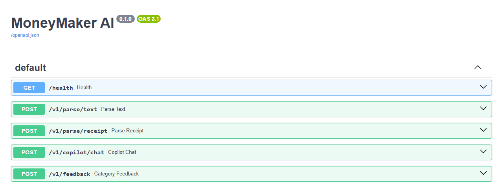

*Figura 5. Swagger UI real (http://localhost:8000/docs, solo fuera de producción): los cinco endpoints del microservicio.*

* **Flujo de comunicación típico (captura por texto).** El usuario escribe o dicta → `services/api.js` envía `POST /v1/parse/text` con `text`, `today`, `currency` y `hints` (correcciones aprendidas) → el backend devuelve las transacciones con sus `highlights` → la app abre la **hoja de confirmación** → solo al pulsar "Confirmar y guardar" el módulo nativo inserta en SQLite. **Nada se guarda en silencio**: ni la IA, ni el OCR, ni las alertas bancarias.

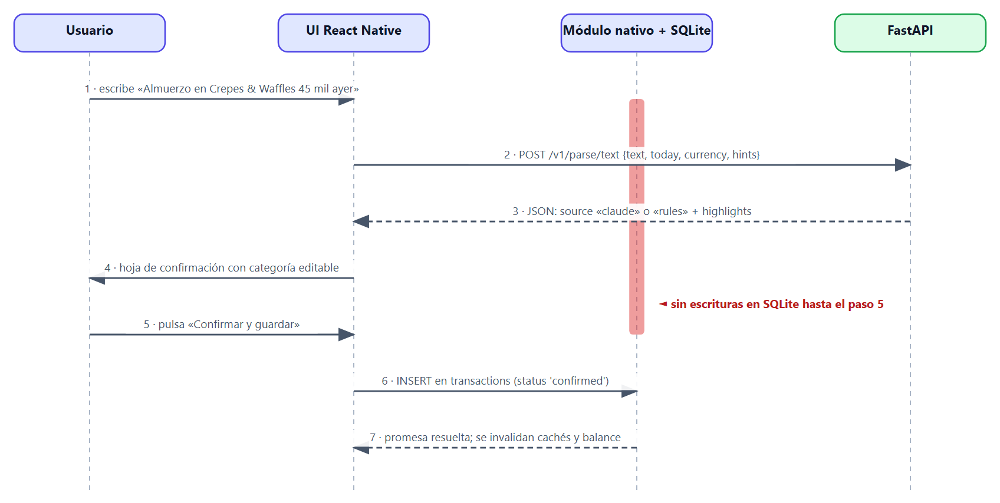

*Figura 6. Secuencia de una captura por texto: la base solo se escribe tras la confirmación explícita del usuario.*

* **Qué sale del teléfono y qué no.**

  | Dato | ¿Sale del teléfono? | Destino y límite |
  |---|---|---|
  | Base SQLite, contraseña de acceso, respaldos | No | Solo el archivo `.mmbackup` cifrado, que el propio usuario guarda en su nube |
  | Texto dictado/escrito | Sí, si usa IA | Backend; máximo 1000 caracteres; hasta 30 `hints` |
  | Foto del recibo | Sí, si usa el escáner | Backend; máximo 8 MB (`MONEYMAKER_MAX_IMAGE_MB`); JPEG, PNG, WebP o GIF |
  | Resumen para el Copilot | Sí, al chatear | Totales del mes, saldo y como máximo 60 movimientos recientes (fecha, tipo, monto, categoría, comercio) y 20 turnos de historial |
  | Correcciones de categoría | Solo con "Compartir correcciones anónimas" activado (apagado por defecto) | `POST /v1/feedback`: comercio, concepto, categorías, origen, confianza y día; nunca montos |

  Cuando la IA de Claude está activa, el texto, la foto o el resumen viajan del backend a la API de Anthropic. Con `MONEYMAKER_AI_MODE=rules` (o sin credenciales) no sale nada hacia terceros y el texto se interpreta con reglas.

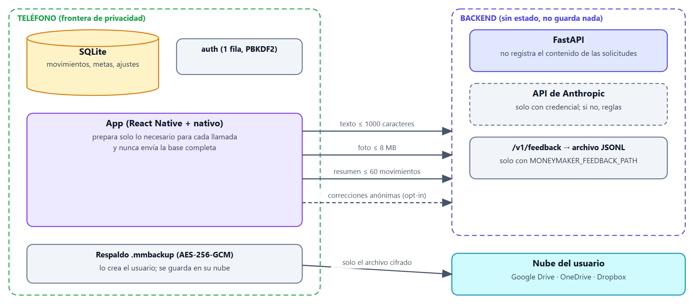

*Figura 7. Frontera de datos: qué cruza del teléfono hacia el backend y hacia la nube del usuario, y con qué límites.*

* **Degradación sin conexión o sin IA.** Si Claude falla, declina o no hay credenciales, `/v1/parse/text` y `/v1/copilot/chat` responden con el motor de reglas (`"source":"rules"`) en lugar de fallar. El escáner de recibos **no** tiene respaldo: sin IA responde 503. Si el backend es inalcanzable, la app muestra "Sin conexión con el servicio de IA." y, tras 45 s sin respuesta, "La IA tardó demasiado en responder. Intenta de nuevo."; el registro manual y la consulta de datos locales no dependen del backend.

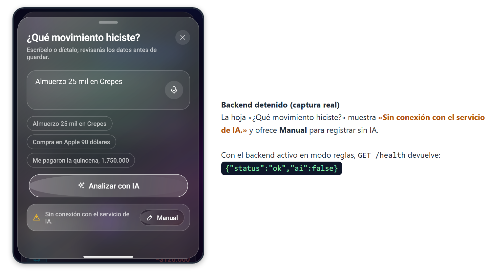

*Figura 8. Captura real con el backend caído: error claro y salida «Manual»; a la derecha, la respuesta real de /health.*

* **Seguridad del transporte.** `network_security_config.xml` permite solo HTTPS con las CA del sistema; el tráfico sin cifrar se admite únicamente hacia `localhost`, `127.0.0.1` y `10.0.2.2` (desarrollo). El backend autentica a la app con la cabecera `X-MoneyMaker-Key` (comparación en tiempo constante contra `MONEYMAKER_APP_TOKEN`). Los datos financieros se excluyen de los respaldos automáticos de Android (`allowBackup="false"` y `data_extraction_rules.xml`).

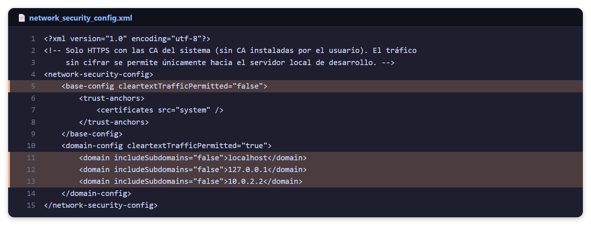

*Figura 9. Archivo real network_security_config.xml: solo HTTPS; texto plano únicamente hacia localhost, 127.0.0.1 y 10.0.2.2.*


---

## 2. Gestión de la Base de Datos Local (SQLite)

La base es un archivo SQLite estándar, versión de esquema 5 (`PRAGMA user_version = 5`), compatible con SQLite 3.9 (Android 7, `minSdk 24`): sin `STRICT`, columnas generadas, UPSERT, `RETURNING` ni funciones de ventana. **No está cifrada en reposo**; el cifrado aplica a los respaldos exportados.

* **2.1 Acceso al archivo .sqlite.** Hay tres escenarios, de menor a mayor riesgo:

  1. **Base de ejemplo del repositorio (recomendado para inspeccionar).** `database/moneymaker.db` trae 46 movimientos (2 pendientes) de agosto a octubre de 2026, 3 metas con 11 aportes, 5 insignias, ajustes y 4 correcciones. En DB Browser for SQLite: **Archivo → Abrir base de datos**. Pestañas útiles: *Estructura de la base de datos*, *Hojas de datos* (tablas y vistas `v_*`), *Ejecutar SQL* y *Editar pragmas*.
  2. **Base de un emulador o teléfono con build de depuración.** Solo funciona con builds `debug` (el `applicationId` es `com.moneymaker`). Cierra la app y copia la carpeta de bases; pasa siempre `-s` porque puede haber un teléfono físico conectado además del emulador:

     ```bash
     adb -s emulator-5554 shell am force-stop com.moneymaker
     adb -s emulator-5554 exec-out run-as com.moneymaker tar -cf - databases > databases.tar
     ```

     Extrae `databases.tar` y abre `moneymaker.db` con DB Browser **junto con** sus archivos `-wal` y `-shm` en la misma carpeta, para no perder escrituras que aún no pasaron al archivo principal.
  3. **Teléfono de producción.** No hay acceso: el build `release` no es depurable (`run-as` falla) y `allowBackup` está desactivado. El único canal soportado es el respaldo `.mmbackup`, que es JSON **cifrado con AES-256-GCM**, no SQLite, así que DB Browser no puede abrirlo. Para inspeccionarlo, restáuralo en un emulador con build de depuración y extrae la base como en el punto 2.


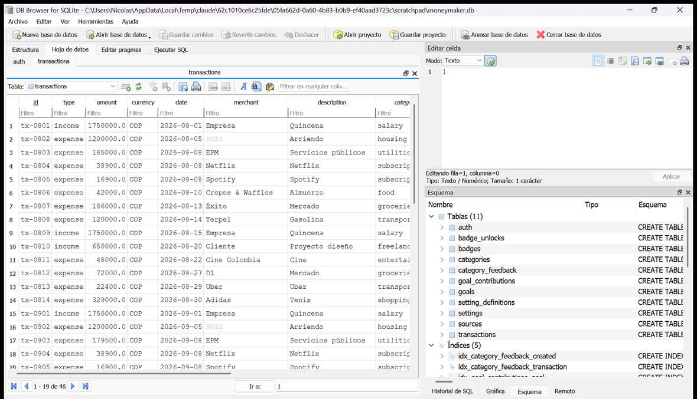

*Figura 10. DB Browser for SQLite 3.13.1 con moneymaker.db: Hoja de datos de «transactions» (46 filas) y el esquema de 11 tablas.*

* **Ajustes obligatorios de DB Browser.** En *Editar pragmas* deja marcada **Claves foráneas** (viene activa por defecto); sin ella SQLite no valida las relaciones. Al guardar, si DB Browser pregunta por el `PRAGMA` final, acepta. Cierra la app antes de abrir una copia extraída y **nunca edites la base mientras la app está abierta**.

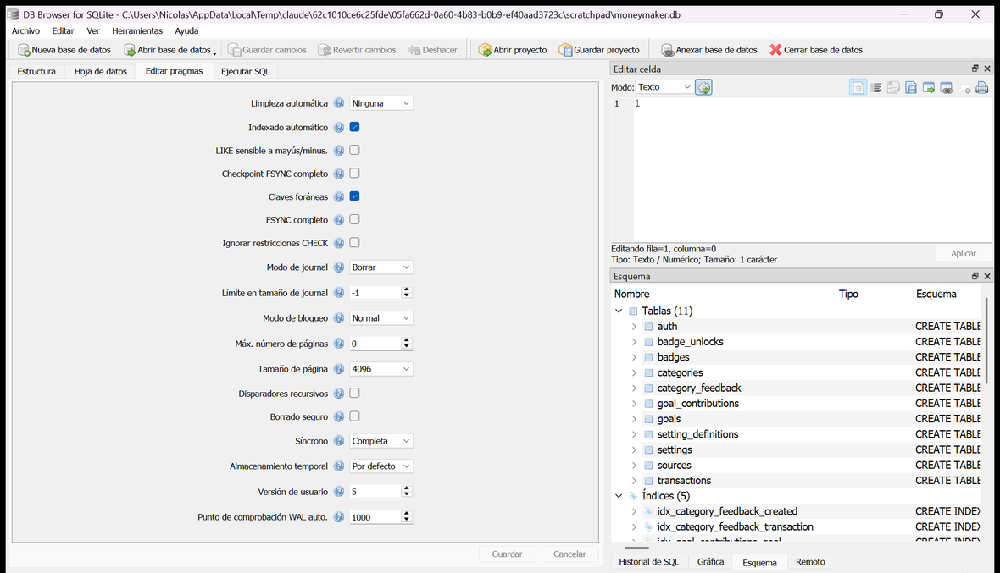

*Figura 11. Editar pragmas: «Claves foráneas» marcada y «Versión de usuario» = 5.*

* **Escribir de vuelta a un emulador (avanzado).** El patrón usado en el proyecto es: detener la app, hacer una copia de seguridad del tar original, editar la copia con DB Browser o Python, subir el archivo con `adb exec-in … cat >` y **borrar `moneymaker.db-wal` y `moneymaker.db-shm`** del dispositivo para que SQLite no reaplique un WAL antiguo. Pruébalo primero en un emulador desechable; no existe herramienta del repositorio que lo automatice.

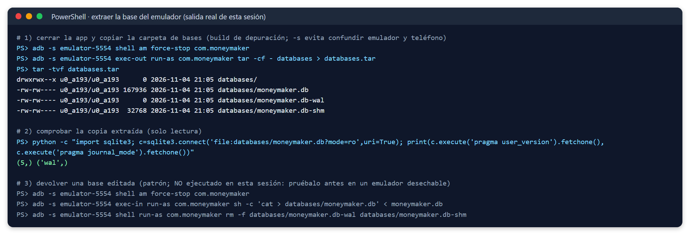

*Figura 12. Extracción real con adb: la base del emulador está en el esquema v5 con journal WAL; el paso 3 es el patrón de reinyección.*

* **Qué protege el propio esquema.** Aunque edites a mano, `CHECK`, claves foráneas y triggers rechazan estados incoherentes: un gasto no puede quedar en la categoría "Salario"; un movimiento confirmado no vuelve a `pending`; `created_at` no cambia; `goals.saved` no se escribe a mano. Si necesitas cambiar el **esquema**: edita `database/esquema.sql`, sube `VERSION` en `FinanceDatabase.java`, escribe el script de migración (como `migracion_v5.sql`) y añade su prueba en `database/construir.py`.

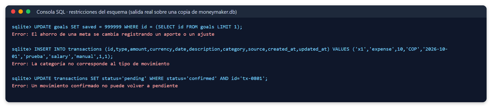

*Figura 13. Salida real: los triggers rechazan editar goals.saved a mano, un gasto en «Salario» y des-confirmar un movimiento.*


* **2.2 Tablas Principales.** El esquema tiene 11 tablas, 5 índices, 11 triggers y 10 vistas. Se agrupan en catálogos (datos fijos que la app define en código) y datos del usuario.

  | Tabla | Papel | Detalles clave |
  |---|---|---|
  | `categories` | Catálogo de 15 categorías (espejo de `theme.js`) | `for_expense` / `for_income` indican si sirve para gasto, ingreso o ambos; "Transferencias" y "Otros" sirven para ambos |
  | `sources` | Origen del movimiento | `manual`, `ai`, `voice`, `receipt`, `sms`, `notification`; `automated = 1` para SMS y notificación |
  | `setting_definitions` | 9 ajustes reconocidos con tipo y valor por defecto | `currency`, `budget`, `onboarded`, `secureScreen`, `reduceEffects`, `shareFeedback`, `lockDelay`, `automation.sms`, `automation.notifications` |
  | `badges` | Catálogo de 9 insignias (espejo de `gamification.js`) | `tier`: bronze / silver / gold |
  | `transactions` | Gastos e ingresos | `type` expense/income, `amount > 0` (el signo lo da `type`), `date` `AAAA-MM-DD`, `status` pending/confirmed, `dedupe_key` única para alertas SMS/notificación, `created_at`/`updated_at` en milisegundos |
  | `goals` | Metas de ahorro | `saved` es derivado: lo recalculan triggers a partir del historial |
  | `goal_contributions` | Historial de cada meta | `kind`: `initial`, `contribution`, `adjustment` (el ajuste puede ser negativo, nunca 0) |
  | `badge_unlocks` | Insignias ganadas y cuándo | Una insignia desbloqueada permanece aunque se rompa la racha |
  | `settings` | Clave/valor | `value` NULL = valor por defecto; formato validado por triggers |
  | `category_feedback` | Correcciones de categoría (feedback loop) | Ver esquema híbrido abajo |
  | `auth` | Acceso local, una sola fila (`id = 1`) | `secret` con formato `pbkdf2-sha256$…`; nunca la contraseña; `failed_attempts` y `locked_until` |

  No existen tablas de presupuestos ni de suscripciones: el presupuesto es el ajuste `budget` y las suscripciones son solo la categoría `subscriptions`.

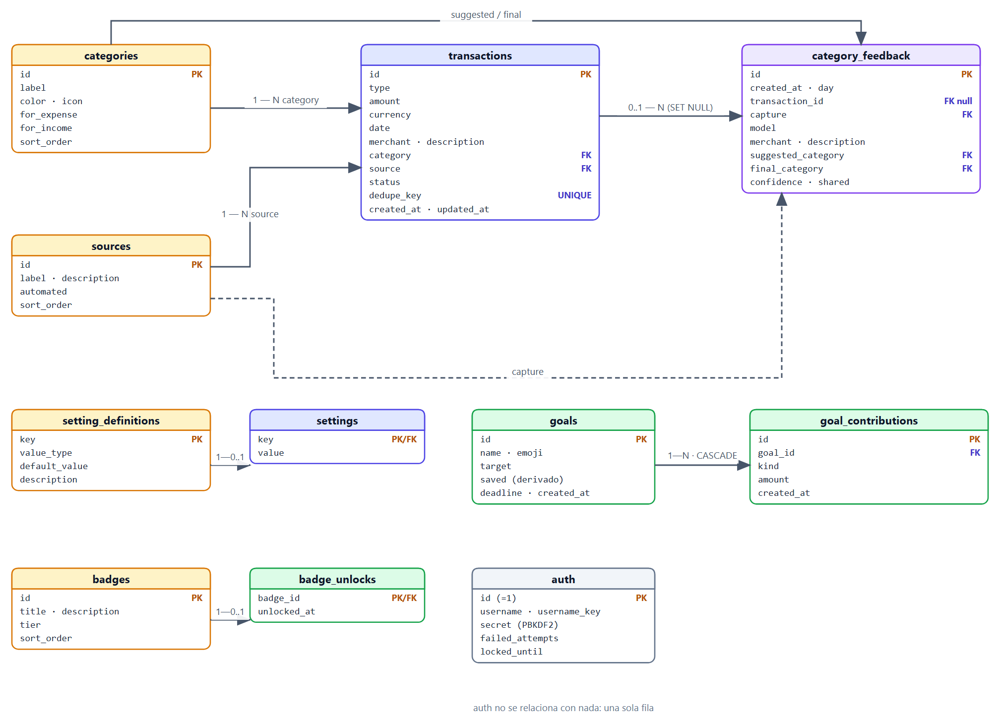

*Figura 14. Diagrama entidad-relación de las 11 tablas del esquema v5 (claves, relaciones y acciones ON DELETE).*

* **Esquema híbrido de IA (confirmación + aprendizaje).** Ningún dato de IA, OCR o alerta bancaria entra como confirmado: llega como borrador (alertas bancarias, además, como `pending`) y se guarda tras la confirmación del usuario. Si el usuario cambia la categoría sugerida, se inserta una fila en `category_feedback` con `model` ∈ {`claude`, `rules`, `bank-parser`, `learned`}, `capture` (origen, distinto de `manual`), `suggested_category`, `final_category` (siempre distintas), `confidence` entre 0 y 1 y `shared` (0 = aún local). Esas filas se convierten en preferencias aprendidas que corrigen las siguientes sugerencias y viajan como `hints` al backend. Un trigger que obligara a que ambas categorías sean del mismo tipo **no** existe a propósito: cambiar el tipo en la hoja de confirmación genera filas legítimas de tipos distintos.

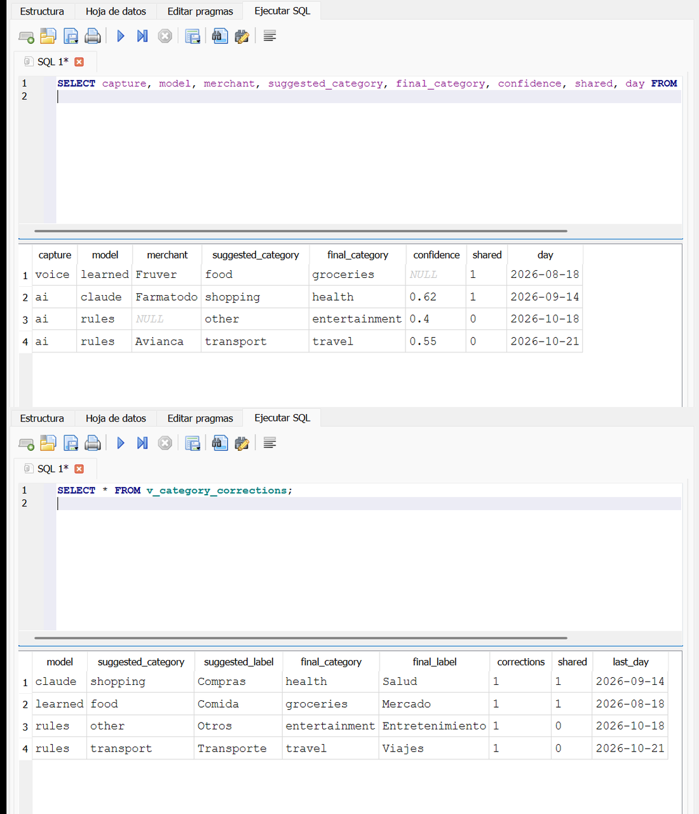

*Figura 15. DB Browser: filas reales de category_feedback (arriba) y su resumen en la vista v_category_corrections (abajo).*

* **Vistas, índices y triggers de apoyo.** Vistas listas para revisar: `v_transactions` (nombres legibles y monto con signo), `v_balance`, `v_monthly_summary`, `v_monthly_category_totals`, `v_pending_transactions`, `v_goal_progress`, `v_goal_contributions`, `v_badges`, `v_settings`, `v_category_corrections`. Índices: `idx_transactions_page (date, created_at, id)` para la paginación con cursor, `idx_transactions_status_date (status, currency, date)` para saldos y totales, y los de `category_feedback` y `goal_contributions`. Triggers: coherencia categoría/tipo, no des-confirmar, `created_at` inmutable, validación de formato de `settings`, los tres que recalculan `goals.saved` al insertar, borrar o editar aportes, y los dos que impiden escribirlo directamente o crear una meta con ahorro distinto de 0.

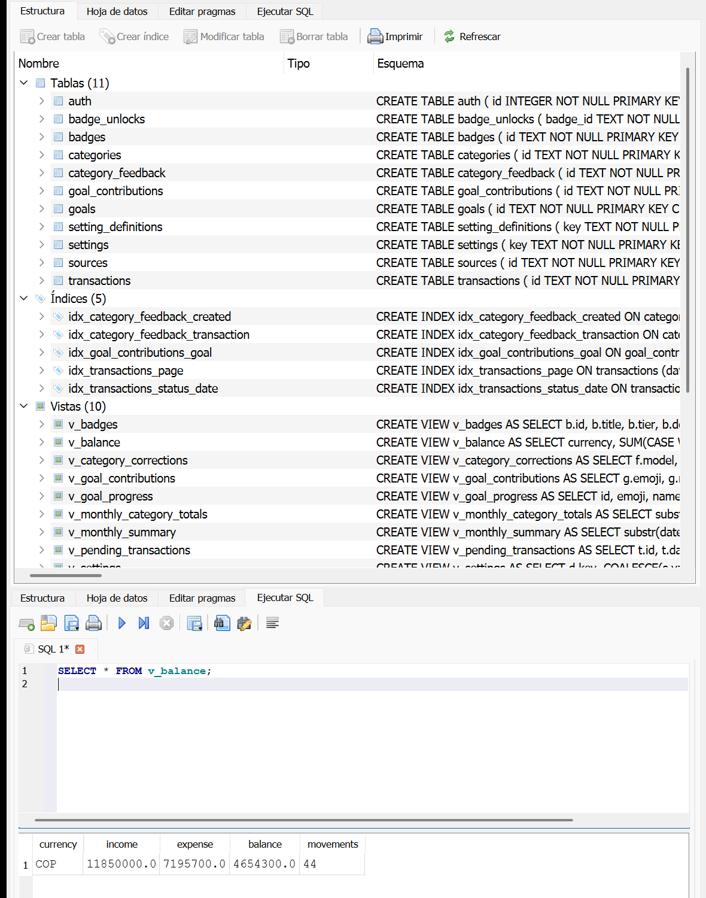

*Figura 16. Pestaña «Estructura»: 11 tablas, 5 índices y 10 vistas (arriba); y la vista v_balance consultada (abajo).*

* **Versionado y migraciones.** v4 añadió catálogos, claves foráneas, CHECK, triggers y vistas; v5 añadió `goal_contributions`, `badges` y `badge_unlocks`. `onUpgrade` corre dentro de una transacción (si algo falla, la base queda como estaba): v4→v5 ejecuta `migracion_v5.sql` (lo ahorrado de cada meta pasa a ser su saldo inicial) y versiones anteriores a v4 se reconstruyen renombrando a `legacy_*`, creando el esquema actual y copiando con `importar.sql`, que corrige lo que el esquema no admite (categoría que no corresponde al tipo → Otros, moneda en minúsculas, fechas inválidas) y descarta lo irrecuperable (montos 0). `python database/construir.py` regenera `moneymaker.db` y ejecuta las pruebas de migración y restauración (204 según `database/README.md`); las migraciones v3→v4 y v4→v5 ya se probaron en emulador con bases sintéticas y con una base real, pero la migración desde bases v1 o v2 no se ha probado en un dispositivo.

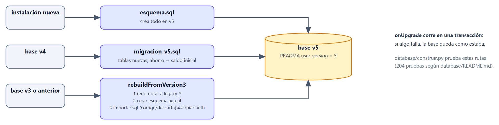

*Figura 17. Rutas de versión: instalación nueva, v4→v5 con migracion_v5.sql, y v3 o anterior reconstruida con importar.sql.*


* **2.3 Ejecución de Queries Analíticas (Time-Travel filtering).** En la app se llama así a la comparativa A/B de dos meses de Analítica: el usuario elige un mes A (analizado) y un mes B (referencia). La app pide a la base `monthlyTotals` (totales por mes, tipo y categoría) y calcula diferencias en JavaScript (`compareMonths`, `deltaOf`). La tendencia es "plana" si el cambio es menor al 0,5 %. Si uno de los meses está en curso, ambos se comparan sobre los mismos días (`dayCutoff`) y el promedio diario usa ese mismo divisor. Las consultas que ejecuta la app están en `database/consultas.sql` (ábrelo en *Ejecutar SQL* y pulsa F5, o Ctrl+Retorno para la selección). La base de totales por mes y categoría es:

  ```sql
  SELECT * FROM v_monthly_category_totals WHERE month = '2026-10' ORDER BY type, total DESC;
  ```


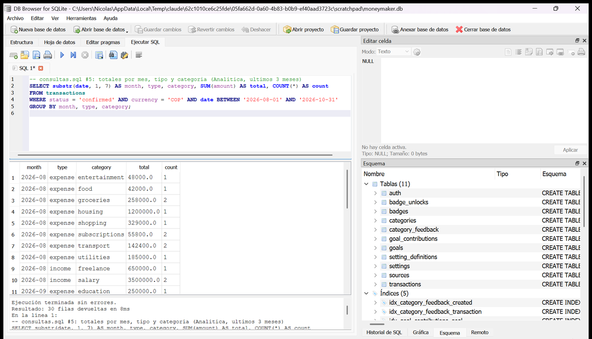

*Figura 18. Consulta 5 de consultas.sql ejecutada en DB Browser: totales por mes, tipo y categoría (agosto–octubre de 2026).*

* **Query de comparativa mes a mes (A = octubre, B = septiembre).** Equivale a la tabla de la pantalla Analítica. Ejecutada contra `database/moneymaker.db` (SQLite 3.49, en modo lectura), devuelve:

  ```sql
  SELECT categoria, mes_a, mes_b, ROUND(mes_a - mes_b, 2) AS diferencia,
         CASE WHEN mes_b = 0 THEN NULL ELSE ROUND((mes_a - mes_b) * 100.0 / mes_b, 1) END AS cambio_pct
  FROM (
    SELECT c.label AS categoria,
           ROUND(SUM(CASE WHEN substr(t.date, 1, 7) = '2026-10' THEN t.amount ELSE 0 END), 2) AS mes_a,
           ROUND(SUM(CASE WHEN substr(t.date, 1, 7) = '2026-09' THEN t.amount ELSE 0 END), 2) AS mes_b
    FROM transactions t
    JOIN categories c ON c.id = t.category
    WHERE t.status = 'confirmed' AND t.type = 'expense' AND t.currency = 'COP'
      AND substr(t.date, 1, 7) IN ('2026-10', '2026-09')
    GROUP BY t.category
  )
  ORDER BY MAX(mes_a, mes_b) DESC;
  ```

  Filas destacadas (11 en total): Vivienda 1.200.000 / 1.200.000 (0 %); Viajes 420.000 / 0 (sin base, `NULL`); Transferencias 300.000 / 0; Mercado 194.000 / 269.000 (−75.000, −27,9 %); Educación 0 / 250.000 (−100 %); Servicios 191.200 / 179.500 (+6,5 %); Comida 94.200 / 144.300 (−34,7 %); Transporte 121.200 / 16.500 (+634,5 %).

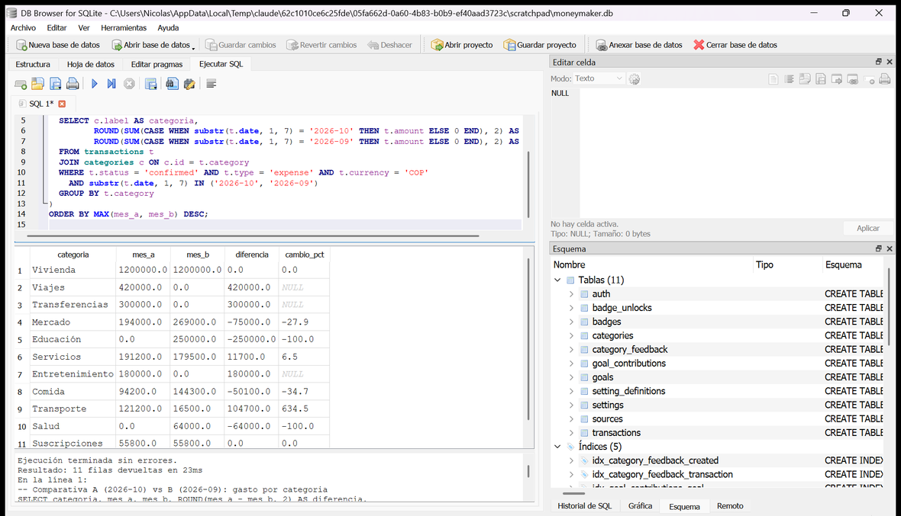

*Figura 19. Comparativa mes a mes A (octubre) vs B (septiembre): 11 filas devueltas, ordenadas por el mayor gasto.*

* **Mismo periodo (días 1 a 15).** Para replicar el recorte de un mes en curso, añade el filtro de día a la subconsulta (`AND CAST(substr(t.date, 9, 2) AS INTEGER) <= 15`). Con la base de ejemplo el resultado cambia de forma visible: Comida pasa a 45.500 vs 48.300 (−5,8 %), Mercado a 194.000 vs 201.000 (−3,5 %) y Transporte a 118.000 vs 0. Esto es lo que evita que la app muestre "gastaste menos" solo porque el mes aún no terminó.

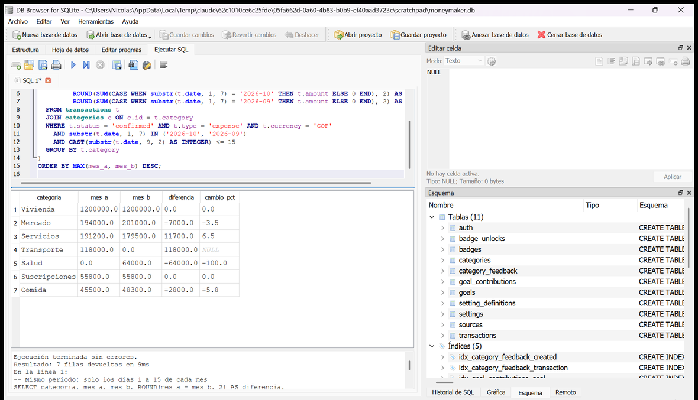

*Figura 20. Misma comparativa limitada a los días 1–15 de cada mes (el «mismo periodo» de un mes en curso).*

* **Otras consultas del panel y revisiones de integridad.** Presupuesto del mes (gastado, restante, porcentaje) combinando `v_settings` y `v_monthly_summary`; comercios con más gasto (`merchantTotals`); gasto por día para la racha de presupuesto; días con registros para la racha de constancia; deduplicación de alertas en una ventana de 10 minutos. Antes de cualquier edición manual, corre `PRAGMA integrity_check;` (debe devolver `ok`) y `PRAGMA foreign_key_check;` (no debe devolver filas); la base de ejemplo pasa ambas.

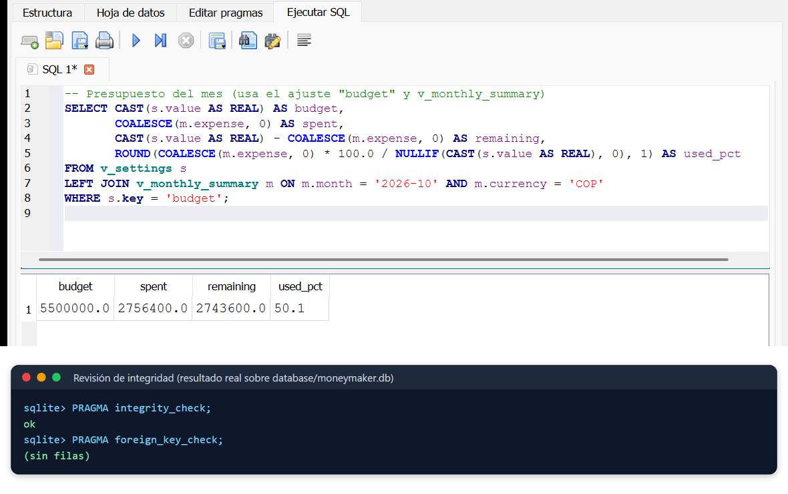

*Figura 21. Presupuesto del mes (v_settings + v_monthly_summary) y las dos revisiones de integridad, con sus resultados reales.*


---

## 3. Configuración del Microservicio de IA (Backend Python)

Stack: Python 3.12, FastAPI (`>=0.115`), Uvicorn, SDK de Anthropic (`>=1.5`), Pydantic 2 y `python-multipart`. Es FastAPI; no hay código Flask.

* **3.1 Endpoints de Conexión.** *(Versión anterior: en la versión sin IA, `config.js` solo conserva `DEFAULT_CURRENCY`, `SPEECH_LOCALE` y `DEV_ALLOW_SCREENSHOTS`.)* **La app React Native no usa un archivo `.env`**: el proyecto no incluye `react-native-config` ni `dotenv`. La URL del backend y el token son constantes en `mobile/src/config.js` y se compilan dentro del paquete JavaScript; cambiarlas exige recompilar. El archivo `.env` pertenece al **backend** (`backend/.env.example`).

  | Constante (`mobile/src/config.js`) | Valor actual | Para qué sirve |
  |---|---|---|
  | `DEV_API_URL` | `http://10.0.2.2:8000` en Android; `http://localhost:8000` en otras plataformas | El emulador Android ve el `localhost` del PC como `10.0.2.2` |
  | `PROD_API_URL` | `https://moneymaker-api.example.com` (**marcador de posición**) | Reemplazar por la URL HTTPS del servicio desplegado |
  | `API_URL` | `__DEV__ ? DEV_API_URL : PROD_API_URL` | Se usa en `services/api.js` |
  | `APP_TOKEN` | `''` | Debe coincidir con `MONEYMAKER_APP_TOKEN` del backend; se envía como `X-MoneyMaker-Key` solo si no está vacío |
  | `REQUEST_TIMEOUT_MS` | `45000` | Tiempo máximo por solicitud |
  | `DEFAULT_CURRENCY` / `SPEECH_LOCALE` | `COP` / `es-CO` | Moneda por defecto y localización del dictado |
  | `DEV_ALLOW_SCREENSHOTS` | `__DEV__` | En desarrollo se permiten capturas; en producción rige el ajuste de la app |

  Dos consecuencias prácticas: (1) en un **teléfono físico** en desarrollo, `10.0.2.2` no resuelve; usa `adb reverse tcp:8000 tcp:8000` y cambia `DEV_API_URL` a `http://localhost:8000` (el tráfico HTTP solo está permitido hacia `localhost`, `127.0.0.1` y `10.0.2.2`, no hacia IP de la red local); (2) como `APP_TOKEN` va dentro del paquete de la app, es un secreto compartido de baja protección: úsalo para evitar tráfico anónimo, no como control de acceso fuerte.

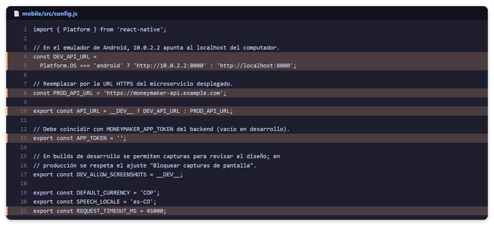

*Figura 22. mobile/src/config.js real: URL de desarrollo y producción, token y tiempo de espera (no hay .env en React Native).*

* **Variables de entorno del backend** (`backend/.env`, copiado de `.env.example` y cargado con `uvicorn … --env-file .env`):

  | Variable | Valor por defecto | Efecto |
  |---|---|---|
  | `ANTHROPIC_API_KEY` | vacío | Credencial de Claude (también se reconocen `ANTHROPIC_AUTH_TOKEN` y `ANTHROPIC_PROFILE`). Sin ella el servicio usa reglas |
  | `MONEYMAKER_ENV` | `development` | `production` oculta `/docs`, `/redoc` y `/openapi.json` y hace que, sin token, los endpoints respondan 503 |
  | `MONEYMAKER_AI_MODE` | `auto` | `auto` (Claude si hay credencial), `claude` (siempre Claude) o `rules` (solo reglas) |
  | `MONEYMAKER_MODEL` | `claude-opus-5` | Modelo usado |
  | `MONEYMAKER_APP_TOKEN` | vacío | Vacío = sin verificación (solo desarrollo); con valor, se exige `X-MoneyMaker-Key` (401 si no coincide) |
  | `MONEYMAKER_FEEDBACK_PATH` | vacío | Archivo JSONL donde se acumulan las correcciones compartidas; vacío = `/v1/feedback` responde 503 y no se guarda nada |
  | `MONEYMAKER_DEFAULT_CURRENCY` | `COP` | Moneda por defecto |
  | `MONEYMAKER_MAX_IMAGE_MB` | `8` | Tamaño máximo de imagen |


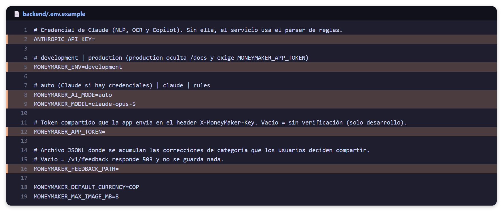

*Figura 23. backend/.env.example real: las variables del servidor (la clave ANTHROPIC_API_KEY va vacía en el repositorio).*

* **Arranque local y comprobación.** Desde `backend/`: crear el entorno virtual, instalar `requirements-dev.txt`, copiar `.env.example` a `.env` y ejecutar `.venv\Scripts\uvicorn app.main:app --reload --env-file .env`. Las pruebas se corren con `.venv\Scripts\python -m pytest`. Comprueba el servicio con `GET /health`, que devuelve `{"status":"ok","ai":true|false}`: `ai` indica si hay credencial (o `MONEYMAKER_AI_MODE=claude`).

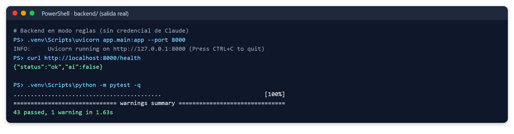

*Figura 24. Comprobación real del backend: /health responde «ai: false» (modo reglas) y la batería de pruebas pasa (43 pruebas).*

* **Despliegue en producción.** Imagen Docker `python:3.12-slim`, usuario sin privilegios (uid 10001), `MONEYMAKER_ENV=production`, puerto 8000, `HEALTHCHECK` contra `/health`, y Uvicorn con `--proxy-headers --no-server-header`. Debe ir detrás de un balanceador con HTTPS. El backend **no** implementa límite de peticiones propio: configúralo en el balanceador o API gateway. La imagen aún no se ha construido en el entorno del proyecto (Docker no está instalado allí).

  ```bash
  docker build -t moneymaker-ai backend
  docker run -p 8000:8000 -e ANTHROPIC_API_KEY=... -e MONEYMAKER_APP_TOKEN=... moneymaker-ai
  ```


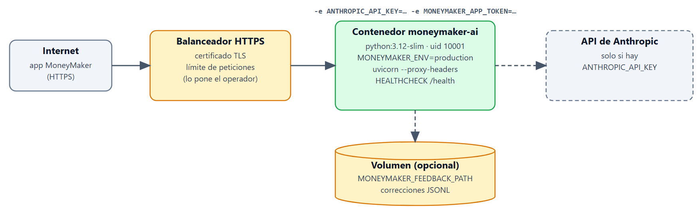

*Figura 25. Despliegue recomendado: balanceador HTTPS → contenedor Docker sin estado → API de Anthropic (opcional).*


* **3.2 Procesamiento NLP/OCR.**
  **Texto (`/v1/parse/text`).** El backend normaliza el texto y, si la IA está activa, pide a Claude una salida estructurada (`beta.messages.parse`, esfuerzo "low") con el contexto de fecha y moneda y los `hints` del usuario; `to_parsed` valida el resultado: fecha inválida → hoy, moneda inválida → la por defecto, categoría que no corresponde al tipo → `other`, `confidence` acotada a [0, 1] y citas de evidencia convertidas en posiciones (`highlights`). Si Claude falla (`APIError`, rechazo o valor inválido), responde el **motor de reglas en español**, que entiende "45 mil", "18k", "lucas", "palos", "ayer", "el lunes", "hace 3 días" y moneda USD/EUR; el campo `source` indica cuál respondió (`"claude"` o `"rules"`).

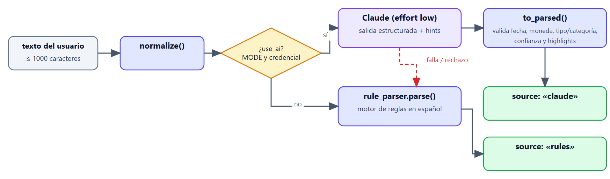

*Figura 26. Flujo de /v1/parse/text: Claude con validación, o motor de reglas como respaldo; «source» indica cuál respondió.*

* **Ejemplo real de respuesta (modo reglas).** Generada ejecutando el parser del repositorio con `today = 2026-11-04` y la solicitud `{"text":"Almuerzo en Crepes & Waffles 45 mil ayer","today":"2026-11-04","currency":"COP","hints":[]}`:

  ```json
  {
    "source": "rules",
    "text": "Almuerzo en Crepes & Waffles 45 mil ayer",
    "transactions": [
      {
        "type": "expense",
        "amount": 45000.0,
        "currency": "COP",
        "date": "2026-11-03",
        "merchant": "Crepes & Waffles",
        "description": "Almuerzo",
        "category": "food",
        "confidence": 0.9,
        "highlights": [
          { "field": "category", "start": 0,  "end": 8 },
          { "field": "merchant", "start": 12, "end": 28 },
          { "field": "amount",   "start": 29, "end": 35 },
          { "field": "date",     "start": 36, "end": 40 }
        ]
      }
    ]
  }
  ```

  Con Claude activo el esquema es idéntico y cambia `"source": "claude"`; los valores de `confidence` y `highlights` los produce el modelo.

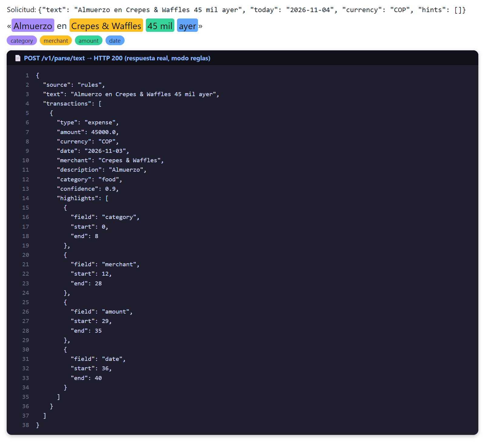

*Figura 27. Respuesta real de /v1/parse/text; los rangos «highlights» se usan para resaltar en la hoja de confirmación.*

* **Recibos (`/v1/parse/receipt`, OCR con visión de Claude).** No hay motor OCR local: la lectura la hace el modelo de visión, por eso **requiere IA** y sin ella responde 503. Validaciones, en orden: `hints` JSON válido (422), tamaño máximo (413), tipo de imagen por firma de bytes —JPEG, PNG, WebP o GIF— (415), IA disponible (503). Errores del modelo: rechazo → 422 "No se pudo leer el recibo"; límite de tasa → 429; sin conexión con la API → 503; otro error HTTP → 502; imagen que no es recibo → 422 "La imagen no parece un recibo". Respuesta: `source`, `transaction` (mismo formato que arriba), `line_items` (`name`, `amount`) y `tax`.

  ```json
  {
    "source": "claude",
    "transaction": {
      "type": "expense", "amount": 87400.0, "currency": "COP", "date": "2026-11-02",
      "merchant": "Supermercado Ejemplo", "description": "Compra de mercado",
      "category": "groceries", "confidence": 0.93, "highlights": []
    },
    "line_items": [ { "name": "Leche", "amount": 5200.0 }, { "name": "Arroz", "amount": 6900.0 } ],
    "tax": 4100.0
  }
  ```

  *(Ilustrativo: respeta el esquema `ReceiptResponse`; los valores son de muestra, no una lectura real.)*

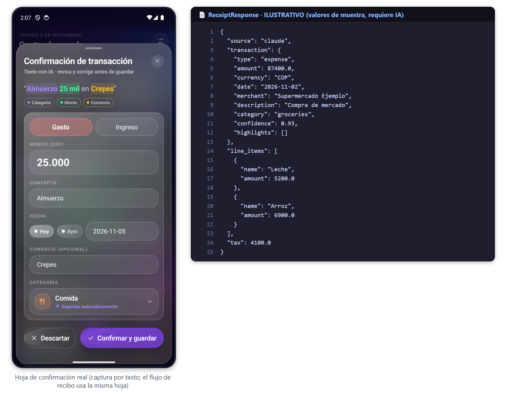

*Figura 28. Izquierda: hoja de confirmación real (nada se guarda hasta «Confirmar y guardar»). Derecha: forma del JSON de recibo (ilustrativo).*

* **Tabla de códigos de error que ve el administrador.**

  | Código | Origen | Significado |
  |---|---|---|
  | 401 | Todos los endpoints | `X-MoneyMaker-Key` no coincide con `MONEYMAKER_APP_TOKEN` |
  | 503 | Todos, en producción | `MONEYMAKER_APP_TOKEN` sin configurar ("Servicio sin configurar") |
  | 413 / 415 / 422 / 429 / 502 / 503 | `/v1/parse/receipt` | Imagen grande / formato no soportado / hints inválidos, rechazo o no es recibo / demasiadas solicitudes / error del servicio de IA / IA no disponible |
  | 503 | `/v1/feedback` | `MONEYMAKER_FEEDBACK_PATH` vacío ("La recolección de correcciones está desactivada") |


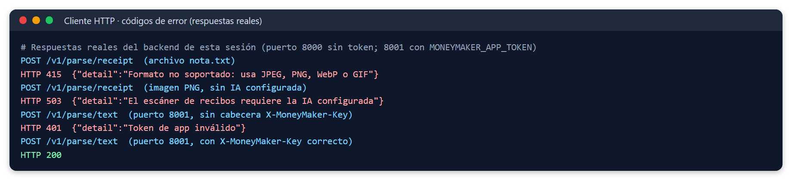

*Figura 29. Errores reales de la API: 415 (formato), 503 (recibo sin IA), 401 (token inválido) y el mismo POST con token correcto.*

* **Copilot y feedback.** `/v1/copilot/chat` recibe un `snapshot` agregado calculado en el teléfono (moneda, saldo, presupuesto del mes, gastado, ingresos, totales por categoría y hasta 60 movimientos recientes) más hasta 20 turnos de historial, y responde con Claude o, si falla o no hay IA, con respuestas basadas en reglas. `/v1/feedback` añade cada corrección como una línea JSON (con `received_at` en UTC) al archivo configurado; no registra IP, token ni texto libre; las filas que fallan quedan pendientes en el teléfono (`shared = 0`) para el siguiente intento.

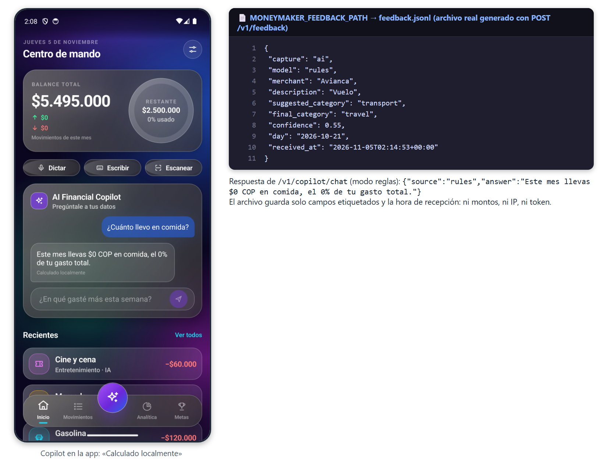

*Figura 30. Izquierda: chat real del Copilot (respuesta del motor de reglas). Derecha: línea real del archivo JSONL de feedback.*


---

## 4. Optimización de Rendimiento (UI y Memoria)

La interfaz es pesada por diseño (desenfoque, degradados, SVG y animaciones). El repositorio implementa las técnicas de abajo, pero no incluye mediciones. Las únicas tomadas para este manual son de un emulador con build de depuración (sección 4.2) y **no** respaldan una cifra de 60 fps ni un consumo de memoria estable: "60 fps" es el objetivo de diseño. Mide en un build `release` y en un teléfono físico antes de afirmarlo.

* **4.1 Renderizado de Glassmorphism.** `components/Glass.js` separa las capas estáticas del cristal del contenido para que no se reprocesen cuando cambia el contenido de la tarjeta:
  * `GlassBackdrop` (desenfoque + relleno + brillo + borde) está envuelto en `memo`.
  * El brillo diagonal (`Sheen`) es un SVG medido con `onLayout`, memorizado y rasterizado en GPU con `renderToHardwareTextureAndroid` y `shouldRasterizeIOS`.
  * `BlurView` usa `blurAmount={22}`, `blurRadius={18}` y `downsampleFactor={6}` (el desenfoque trabaja sobre una versión reducida).
  * Con "Modo ahorro de batería" (o automáticamente si el sistema pide reducir el movimiento) se retira el `BlurView` y se usa un relleno translúcido fijo.
  * Fondo de malla (`MeshBackground`): las manchas se rasterizan una vez y solo se anima su transformación con el driver nativo; se pausa con la app en segundo plano.
  * Las tarjetas sin necesidad de desenfoque (`Chip`, secciones de Ajustes) usan `blur={false}`; úsalo en listas.

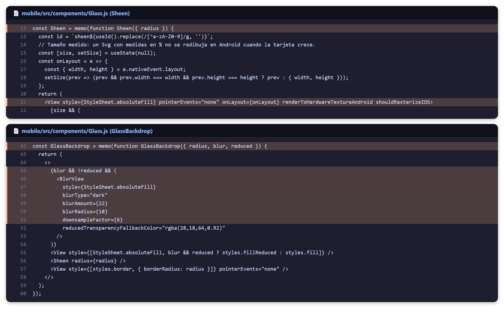

*Figura 31. Código real de Glass.js: capas del cristal memorizadas (memo), brillo rasterizado en GPU y BlurView con downsampleFactor.*

* **Cuidado con el layout del cristal.** Una tarjeta presionable pone sus estilos de disposición (`flex`, `width`, márgenes, posición) en el `Pressable` externo y los visuales en el cristal (`splitLayoutStyle`). Si pones `flex: 1` dentro del cristal, la tarjeta colapsa a altura cero en filas. Las hojas inferiores necesitan `flexShrink` en marco, tarjeta y contenido para que los botones del pie sigan visibles.

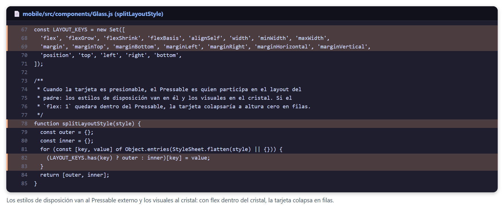

*Figura 32. Código real: splitLayoutStyle separa los estilos de disposición (Pressable) de los visuales (cristal).*

* **Modo ahorro de batería.** Está en **Ajustes y privacidad › Rendimiento**; se guarda en el ajuste `reduceEffects` y se activa solo si `AccessibilityInfo` informa que el usuario pidió reducir el movimiento. Quita el desenfoque y detiene el fondo animado y el pulso del botón ✦. Es el primer paso de diagnóstico ante "va lento": si mejora, el cuello de botella es el desenfoque.

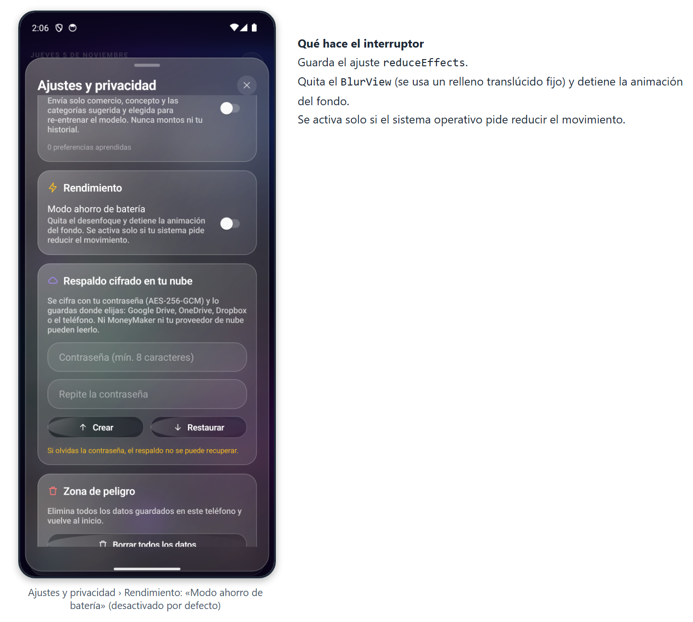

*Figura 33. Captura real de la sección «Rendimiento» de Ajustes, junto a lo que hace el interruptor.*

* **Estado y consultas.** Al abrir la app se pide un único snapshot SQL (balance, totales del mes y 3 previos, recientes, pendientes y fechas de racha); Analítica, Metas, Movimientos y el Copilot piden sus datos al abrirse. Las consultas por pestaña se cachean y se invalidan solo cuando algo escribe en la base. Los agregados (totales, comercios, estadísticas) se calculan en SQLite con índices, no en JavaScript; la inserción masiva (datos de ejemplo) va en una sola transacción.

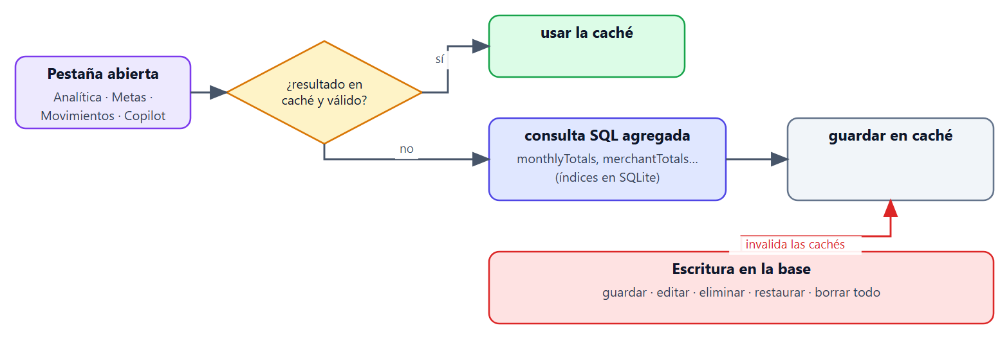

*Figura 34. Estado con carga perezosa: cada pestaña consulta al abrirse, se cachea y solo una escritura invalida las cachés.*


* **4.2 Virtualización de Listas.** El historial **no usa `FlatList` ni `RecyclerView`**: usa `SectionList` (virtualizada, agrupa por día) en `screens/TransactionsScreen.js`, con paginación por cursor desde SQLite:

  | Propiedad | Valor | Efecto |
  |---|---|---|
  | `PAGE_SIZE` | `30` | Filas por página |
  | `onEndReachedThreshold` | `0.6` | Pide la siguiente página al acercarse al final |
  | `initialNumToRender` | `12` | Filas del primer render |
  | `maxToRenderPerBatch` / `updateCellsBatchingPeriod` | `10` / `40` | Filas por lote y ms entre lotes |
  | `windowSize` | `7` | Pantallas montadas alrededor de la visible |
  | `removeClippedSubviews` | `true` solo en Android | Desmonta vistas fuera de pantalla |

  Además: `groupByDay` va en `useMemo`; `renderItem` y `renderSectionHeader` van en `useCallback`; `keyExtractor` es una función estable (`tx => tx.id`); y `TransactionRow`, `CategoryBubble`, `DonutChart` e `IncomeExpenseChart` están envueltos en `memo`. La paginación usa el cursor `(date, created_at, id)` respaldado por `idx_transactions_page`, de modo que cada página cuesta lo mismo sin importar cuántos movimientos haya:

  ```sql
  SELECT * FROM transactions
  WHERE status = 'confirmed' AND type = 'expense'
    AND (date < '2026-10-08' OR (date = '2026-10-08' AND (created_at < 1791502200000
         OR (created_at = 1791502200000 AND id < 'tx-1003'))))
  ORDER BY date DESC, created_at DESC, id DESC
  LIMIT 30;
  ```

  Ajuste fino: subir `windowSize` o `initialNumToRender` reduce los espacios en blanco al desplazarse rápido pero aumenta la memoria; bajarlos hace lo contrario.

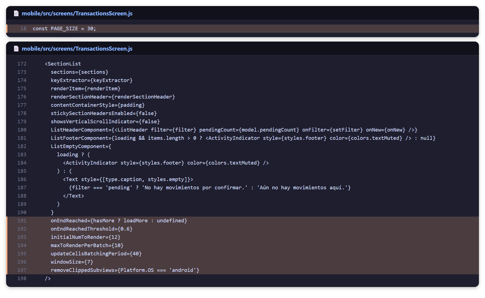

*Figura 35. Código real de la lista: SectionList virtualizada con paginación (PAGE_SIZE = 30) y ventana de renderizado acotada.*

* **Medición real y cómo repetirla.** Con `dumpsys` sobre el emulador `Vida_Pixel` (build de **depuración**, solo 10 movimientos) y 12 desplazamientos por Movimientos se obtuvo: `gfxinfo` → 637 cuadros, 8 lentos (1,26 %), percentil 50 = 30 ms, 90 = 36 ms, 99 = 48 ms; `meminfo` → PSS total de 346.093 KB a 406.779 KB (heap nativo de 233.902 a 294.639 KB). **Lectura honesta:** es un emulador con herramientas de desarrollo y una lista corta, así que no demuestra un consumo estable —la memoria subió— ni 60 fps. Para decidir, repite en un build `release` y en un teléfono físico: (1) Android Studio → *Profiler* → proceso `com.moneymaker` → *Memory*, desplazándote por Movimientos con los datos de ejemplo de la app (5 meses); (2) React DevTools (modo desarrollo) → *Profiler*: las filas fuera de la ventana no deben re-renderizarse al cargar la página siguiente. Comparar con y sin "Modo ahorro de batería" aísla el costo del desenfoque.

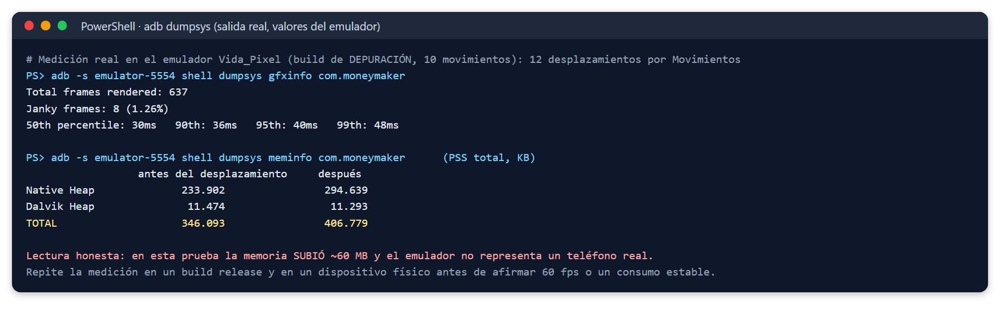

*Figura 36. Mediciones reales (emulador, build de depuración): 1,26 % de cuadros lentos, p50 = 30 ms; la memoria subió durante la prueba.*


---

## 5. Respaldo, Sincronización y Privacidad

* **5.1 Sincronización Local-First.** **No existe sincronización automática ni un interruptor de "Sincronización en la nube cifrada", y no hay integración con iCloud.** El respaldo es **manual** y solo en **Android**: el usuario crea un archivo cifrado y lo guarda con el selector de documentos del sistema (Storage Access Framework) donde quiera —Google Drive, OneDrive, Dropbox o una carpeta del teléfono— siempre que la app de ese proveedor esté instalada. MoneyMaker nunca ve ni aloja el archivo. En la app: **Ajustes y privacidad › Respaldo cifrado en tu nube** → contraseña (mínimo 8 caracteres) y confirmación → **Crear**. El archivo se llama `moneymaker-AAAA-MM-DD.mmbackup`. En iOS la sección muestra "Los respaldos cifrados están disponibles en Android."

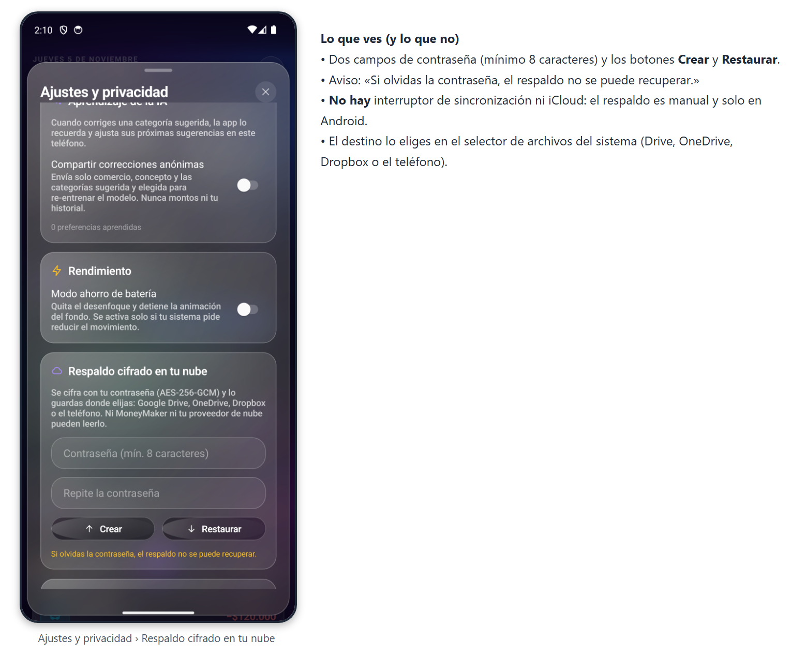

*Figura 37. Captura real de la sección de respaldo: contraseña, Crear y Restaurar; no existe un interruptor de sincronización.*

* **Qué contiene el respaldo y cómo se cifra.** El contenido es un JSON con `format: "moneymaker-backup"`, `version: 3`, `exported_at` y las colecciones `transactions`, `goals`, `settings`, `category_feedback`, `goal_contributions` y `badge_unlocks`. **No incluye el usuario ni la contraseña de acceso** (la tabla `auth`). Se cifra con AES-256-GCM; la clave se deriva de la contraseña del respaldo con PBKDF2-HMAC-SHA256 (600.000 iteraciones). Formato binario: `"MMBK"` · versión (1 byte) · iteraciones (4 bytes) · sal (16) · IV (12) · texto cifrado + etiqueta GCM (16). El encabezado va autenticado (AAD): cualquier alteración invalida el archivo. Al leer se rechazan iteraciones fuera de 100.000–10.000.000 y archivos de más de 50 MB. La contraseña del respaldo es independiente de la de acceso a la app.

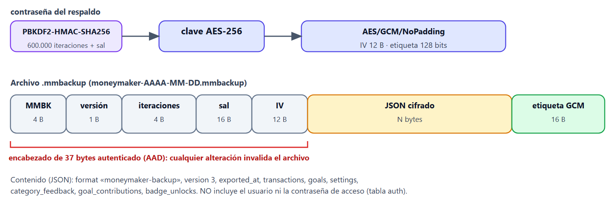

*Figura 38. Formato binario del respaldo .mmbackup: encabezado autenticado, derivación de clave PBKDF2 y cifrado AES-256-GCM.*

* **Capas de privacidad del dispositivo.** Acceso local con usuario y contraseña (no hay servidor ni "Zero-Login" puro): la contraseña se guarda derivada con PBKDF2-HMAC-SHA256 (210.000 iteraciones, sal aleatoria) y se compara en tiempo constante; tras 5 intentos fallidos la espera se duplica hasta un tope de 15 minutos, con el contador guardado en la base (`failed_attempts`, `locked_until`) para que reiniciar la app no lo salte. `FLAG_SECURE` bloquea capturas y oculta la app en recientes (ajuste `secureScreen`, activo por defecto). `allowBackup="false"` y las reglas de extracción excluyen base de datos, preferencias y archivos de las copias automáticas de Android. Las alertas bancarias se analizan en el dispositivo y solo se guardan monto, comercio y fecha, como pendientes. **Límite conocido:** el bloqueo controla el acceso a la app; la base no está cifrada en reposo (se recomienda SQLCipher con clave en Android Keystore).

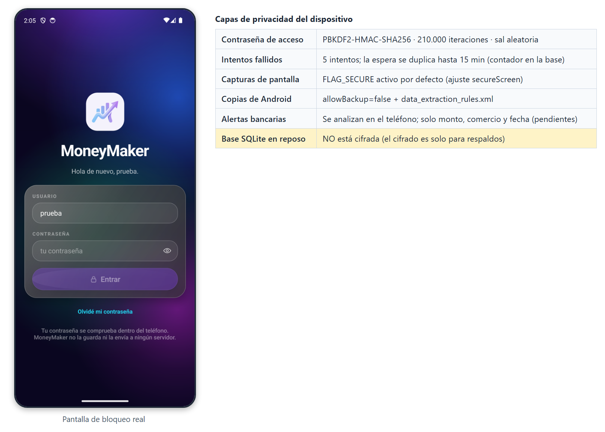

*Figura 39. Pantalla de bloqueo real y resumen de las capas de privacidad; la base en reposo no está cifrada.*

* **Estado de verificación.** Probado en emulador (Pixel, Android 14): onboarding, datos de ejemplo, pestañas principales, captura por texto en modo reglas, y migraciones v3→v4 y v4→v5 con una base real. **Sin probar en dispositivo** (al 26 de octubre de 2026): el selector de archivos del respaldo cifrado, dictado, cámara/OCR, lectura real de SMS y notificaciones y el Copilot/OCR con Claude. Las pruebas unitarias de Java (`BackupCipherTest`) cubren el cifrado; no la interacción con el selector de archivos.

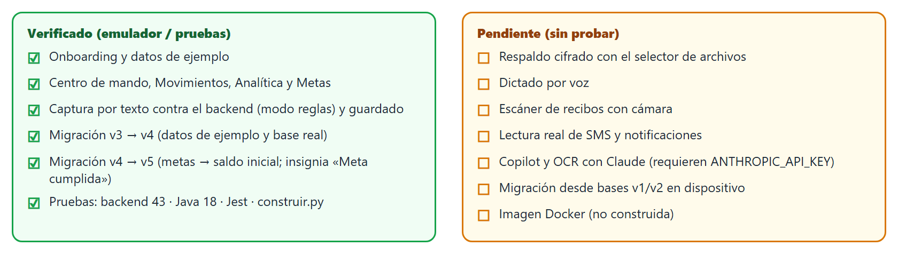

*Figura 40. Estado de verificación del proyecto: qué se ha comprobado y qué sigue sin probarse en dispositivo.*


* **5.2 Recuperación ante desastres.** Al desinstalar la app Android elimina su almacenamiento privado, y con `allowBackup=false` no hay restauración automática del sistema: **el único camino es el archivo `.mmbackup`**. Procedimiento:
  1. Instala MoneyMaker y ábrela: aparece la pantalla de Bienvenida.
  2. Crea un acceso (usuario y contraseña). Es un acceso **nuevo**: no se restaura del respaldo.
  3. Abre **Ajustes y privacidad › Respaldo cifrado en tu nube** y escribe la contraseña **con la que se creó el respaldo**.
  4. Toca **Restaurar** y confirma el aviso *"Se reemplazarán todos tus movimientos, metas y ajustes actuales por los del archivo."*
  5. Elige el archivo `.mmbackup` en el selector del sistema.
  6. La app muestra "Respaldo restaurado: N movimientos y M metas." y recarga los datos.

  La restauración es **todo o nada**: se descifra y valida el archivo completo antes de tocar la base; los datos entran por `importar.sql` (acepta respaldos v1, v2 y v3, corrige lo inválido y descarta lo irrecuperable, de modo que el conteo final puede ser menor que el del archivo) y el reemplazo corre en una transacción. Los respaldos v1 y v2, que no traen historial de metas, reciben un saldo inicial igual a lo ahorrado. Las insignias se vuelven a evaluar tras cada cambio de datos.

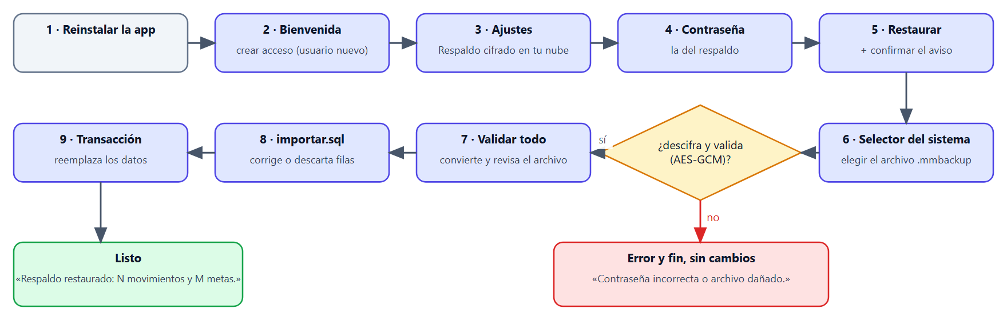

*Figura 41. Restauración tras reinstalar: acceso nuevo, contraseña del respaldo, validación completa y reemplazo en una sola transacción.*

* **Errores de respaldo y qué hacer.**

  | Mensaje en la app | Causa | Acción |
  |---|---|---|
  | La contraseña debe tener al menos 8 caracteres. | Contraseña corta al crear o restaurar | Usar 8 o más caracteres |
  | Las contraseñas no coinciden. | Confirmación distinta al crear | Reescribir |
  | Contraseña incorrecta o archivo dañado. | Etiqueta GCM no válida | Verificar la contraseña; si el archivo se modificó o truncó, usar otra copia |
  | Ese archivo no es un respaldo de MoneyMaker. | Formato/versión de encabezado no reconocido | Elegir el `.mmbackup` correcto |
  | Ya hay un respaldo en curso. | Operación simultánea | Esperar |
  | Abre la app e intenta de nuevo. | Sin actividad en primer plano | Reintentar con la app abierta |
  | No se pudo leer o escribir el archivo. | Error de E/S del proveedor | Reintentar o elegir otra ubicación |

  **No hay recuperación de contraseña:** sin la del respaldo, el archivo es irrecuperable; sin la de acceso, la salida es **"Olvidé mi contraseña"** en la pantalla de bloqueo, que borra los datos locales (y el acceso) para empezar de nuevo y luego restaurar un respaldo.

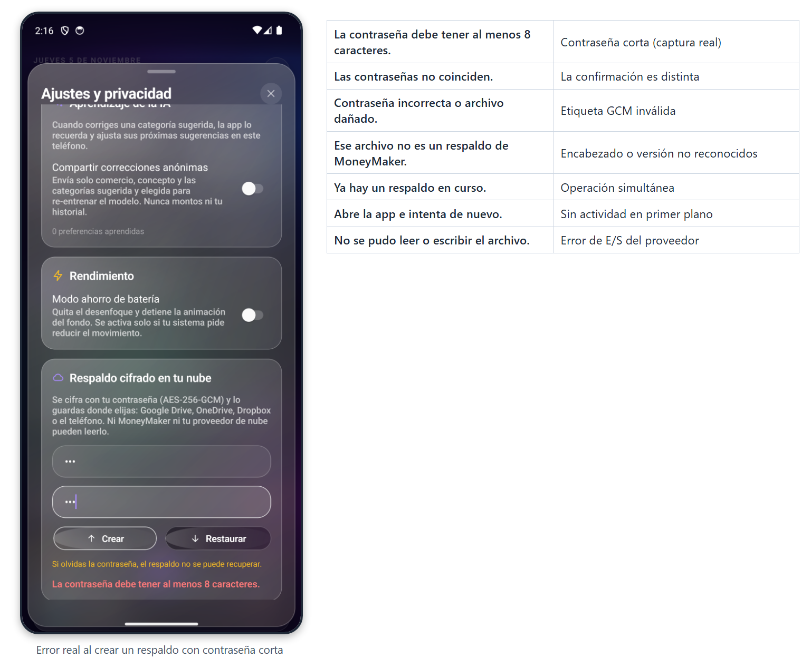

*Figura 42. Captura real del error de contraseña corta y la lista de mensajes de respaldo con su causa.*

* **Rutina recomendada para el administrador.** Crear un respaldo antes de actualizar la app (la migración corre en una transacción, pero un respaldo es la red de seguridad), antes de "Borrar todos los datos" y antes de cualquier edición manual de la base en un emulador; guardar el `.mmbackup` y su contraseña en lugares distintos; y probar la restauración en un emulador de vez en cuando.

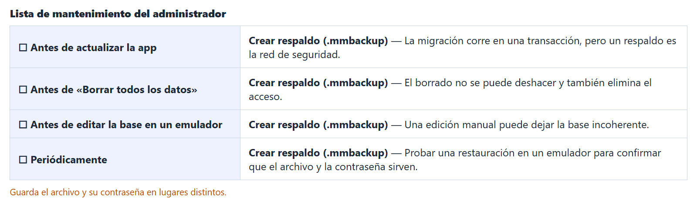

*Figura 43. Lista de mantenimiento: cuándo crear respaldos y cómo comprobar que se pueden restaurar.*


---

## Apéndice A. Límites conocidos y brechas de alcance

Estos puntos son hechos del repositorio a la fecha de este manual; conviene revisarlos antes de afirmar cualquier garantía hacia usuarios finales.

* **Sin sincronización automática ni iCloud**; el respaldo es manual y solo Android. iOS no tiene módulo nativo (almacén en memoria; sin dictado, alertas ni respaldos).
* **Base local sin cifrar en reposo**; solo los respaldos exportados van cifrados.
* **Acceso con usuario y contraseña locales** (no es "Zero-Login"). Sin servidor: no se puede restablecer una contraseña olvidada.
* **No hay panel de administración centralizado**: la administración es por archivo, `adb`, DB Browser y las variables de entorno del backend.
* **El backend tiene un tercero opcional**: la API de Anthropic, cuando hay credencial. En modo `rules` no sale nada del backend.
* **Sin límite de peticiones propio** en el backend; `PROD_API_URL` es un marcador de posición; la imagen Docker no se ha construido en el entorno del proyecto.
* **Build `release` firmado con la clave de depuración** (`signingConfig signingConfigs.debug` en `build.gradle`): genera tu propio keystore antes de publicar.
* **`RECEIVE_SMS`** es un permiso restringido en Google Play; la vía más segura para publicar es el lector de notificaciones.
* **Rendimiento sin cuantificar en hardware real:** la única medición (emulador, build de depuración) muestra 1,26 % de cuadros lentos y un aumento de unos 60 MB de memoria durante la prueba; falta medir en `release` y en un teléfono físico.

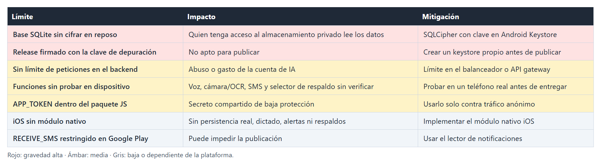

*Figura 44. Resumen de límites conocidos, su impacto y su mitigación, con código de color por gravedad.*

